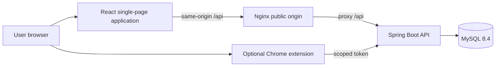
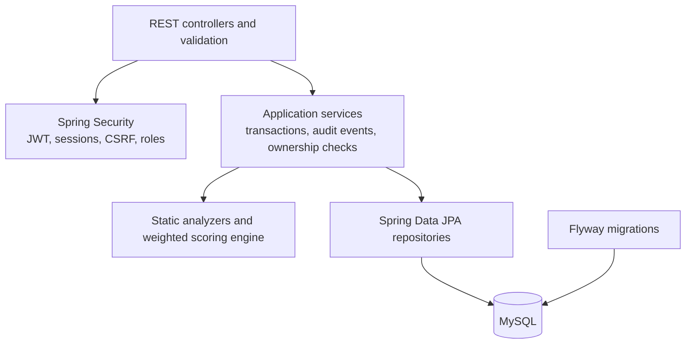
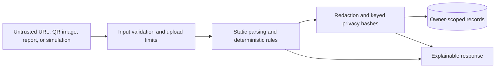

# TRUSTLAYER architecture

## Scope of the current implementation

TRUSTLAYER is a Java/Spring Boot and React application that helps a signed-in user assess a
submitted URL, QR-image destination, simulated transaction scenario, or community threat report.
The current risk decisions use deterministic, transparent weighted rules. There is no trained
machine-learning classifier, live malware feed, bank connection, payment-provider integration,
or unrestricted URL fetching in this repository.

That distinction matters. The platform can explain why a static input looks risky; it cannot
prove that a site is safe, verify a real financial transaction, or stop a real payment.

## Runtime topology

The provided Docker Compose deployment keeps Nginx bound to `127.0.0.1:8088`. It is a local
hackathon demonstration topology, not a public Internet deployment. A public deployment needs a
separate trusted HTTPS reverse proxy or load balancer in front of this topology.

## Backend layers

- **Controller layer:** accepts only DTOs, applies Bean Validation, and returns a consistent API
  envelope. A centralized exception handler prevents stack traces from leaking to clients.
- **Security layer:** validates short-lived access JWTs and checks their backing database session
  on protected requests. Refresh credentials remain in an HttpOnly cookie and browser mutations
  require CSRF protection.
- **Service layer:** owns user isolation, rate limits, persistence orchestration, audit records,
  and database transactions. Controllers do not manipulate entities directly.
- **Analyzer and risk layers:** emit named evidence signals. `WeightedRiskScoringEngine` owns score
  capping, score bands, provenance checks, confidence, limitations, and explanation output.
- **Repository and database layers:** use Spring Data JPA for application reads/writes. Flyway,
  rather than Hibernate, owns every schema change. Hibernate runs only in `validate` mode.

## Security and privacy trust boundaries

The URL and QR features deliberately do not resolve DNS, open HTTP connections, follow redirects,
load web content, inspect certificates, or execute payment instructions. This blocks the most
obvious SSRF path and prevents the product from becoming an unbounded network scanner. It also
means that domain reputation, redirects, WHOIS data, certificates, and dynamic phishing content
are outside the current decision boundary.

Sensitive submitted fields are minimized before persistence:

- URL credentials, path values, query values, and fragments are redacted.
- QR content and payment details are classified locally and not executed.
- Transaction beneficiary values are represented by keyed hashes for historical comparison.
- Community indicators are canonicalized and privacy-hashed; unverified reports never become
  confirmed fraud merely because multiple people submitted them.

## Authentication and extension boundary

The main web application has one browser-session model: a fifteen-minute access JWT, a rotating
seven-day refresh credential in an HttpOnly `SameSite=Strict` cookie, database-backed session
revocation, and a readable anti-CSRF cookie/header pair for state-changing browser calls.

The optional Chrome extension intentionally does **not** receive that web credential. It uses an
explicit consent flow with a one-minute, SHA-256-hashed, S256 PKCE authorization code. The
extension exchanges the code for a five-minute, audience-restricted, `url:scan` token stored in
`chrome.storage.session`. The token can only call the extension scan endpoint, and that endpoint
rechecks the parent session. Exact extension origin, callback URI, and CORS origin configuration
are required.

The extension source and backend authorization tests exist, but a human has not yet loaded and
connected it in Chrome in this workspace. Its real browser protection status remains unverified.

## Data ownership and authorization

Every private scanner result, simulated transaction, session, and account profile belongs to one
authenticated user. Services and repository queries enforce owner scoping. Requests for another
user's scanner record return 404 rather than revealing whether the record exists. Administrative
threat verification requires an ADMIN role stored in the database; normal registration creates a
USER role only.

## Production constraints

The `prod` profile fails startup when the cookie is not Secure, email action tokens are exposed,
the privacy HMAC key equals the JWT key, or the JWT secret is not base64-decoded to at least 32
bytes. These guards reduce accidental deployment mistakes. They do not replace TLS configuration,
a secret manager, independently reviewed infrastructure, backups, monitoring, distributed rate
limits, or a formal incident-response process.
